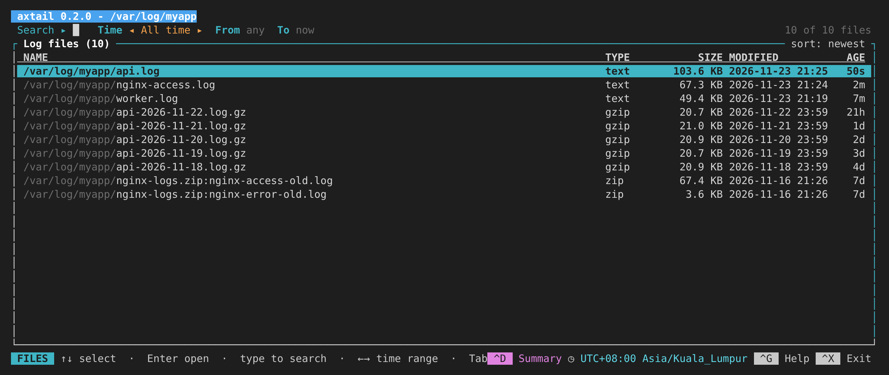
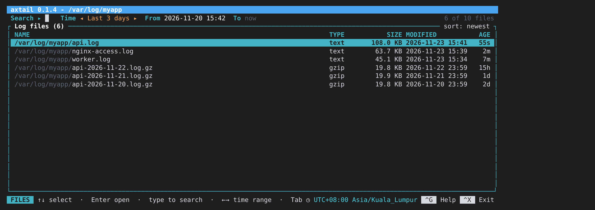
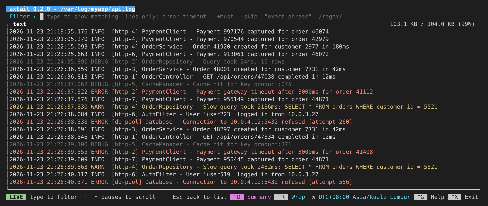
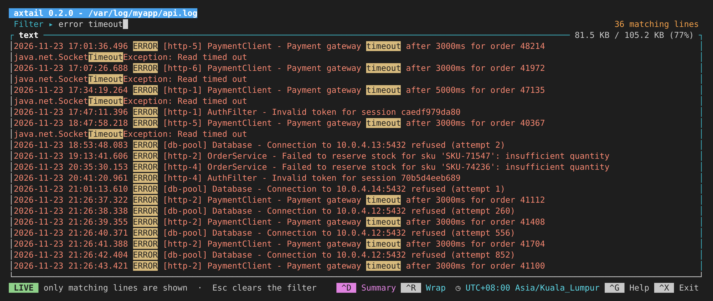
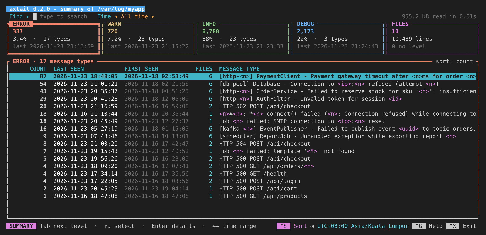
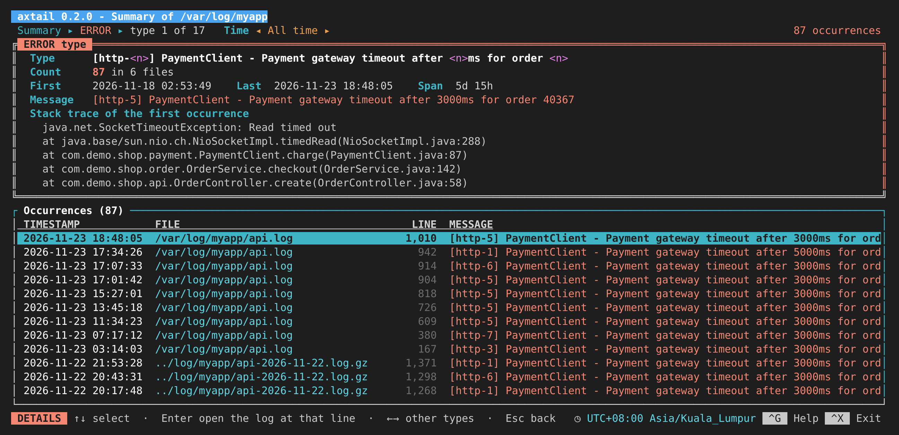
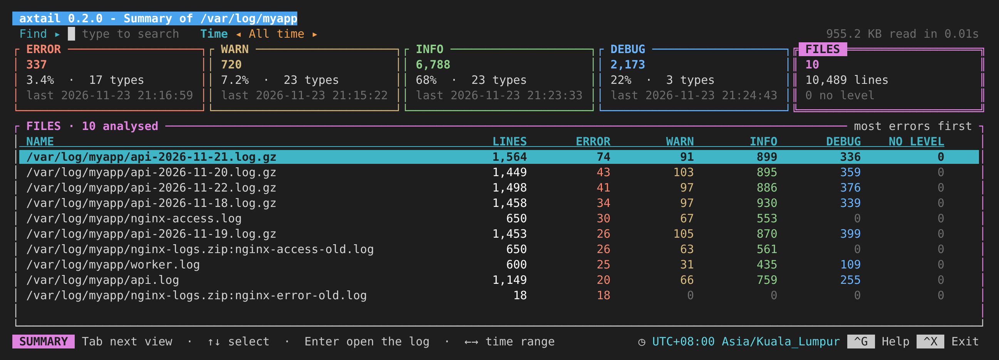
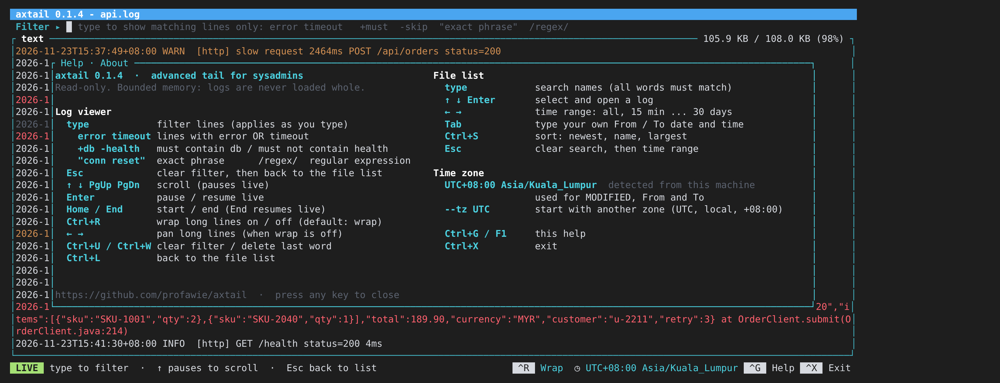

# axtail

**axtail** (advanced tail) is a fast, read-only terminal log viewer for sysadmins.
It helps you find the root cause in log files over SSH: plain files, gzip, zip
and Docker container logs, all in one coloured text interface.

## Install on a Linux server

One line, straight from GitHub. The server needs no Rust, only `curl` (or `wget`):

```sh
# system-wide for all users: /usr/local/bin/axtail
curl -fsSL https://raw.githubusercontent.com/profawie/axtail/main/install.sh | sudo sh

# current user only, no root: ~/.local/bin/axtail
curl -fsSL https://raw.githubusercontent.com/profawie/axtail/main/install.sh | sh
```

This downloads the static binary for the server's CPU (x86_64 or aarch64) from the
[latest release](https://github.com/profawie/axtail/releases/latest), verifies it against
the release's `SHA256SUMS`, and installs it. Run the same command again to upgrade.
Options go after `sh -s --`:

```sh
curl -fsSL https://raw.githubusercontent.com/profawie/axtail/main/install.sh | sh -s -- --version v0.1.0
curl -fsSL https://raw.githubusercontent.com/profawie/axtail/main/install.sh | sudo sh -s -- --uninstall
```

| Option | Result |
| --- | --- |
| `--dir <DIR>` | Install into a specific directory |
| `--version <TAG>` | Install a specific release instead of the latest |
| `--download` | Always download, even when an `axtail` file sits next to the script |
| `--uninstall` | Remove axtail (use `sudo` or `--dir` the same way it was installed) |

**Servers without internet access.** Copy two files and run the script there. It installs
the `axtail` file next to it instead of downloading:

```sh
./build.sh                                # or download the binary from the releases page
scp axtail install.sh user@server:/tmp/
ssh user@server sudo /tmp/install.sh
```

Inside a clone on a machine with Rust, `./install.sh` builds the binary first if it is
missing. The script refuses to install a binary that does not run on the machine.

**Windows.** Download `axtail-windows-x86_64.exe` from the
[releases page](https://github.com/profawie/axtail/releases/latest), or build with `.\build.ps1`.

## Screenshots

All screenshots use made-up demo logs.

**File list.** Point axtail at a folder: plain logs, `.gz` archives and the files inside a
`.zip` are listed together, newest first, with size, modified time and age.



**Time range.** Press `Left` / `Right` to pick a range (here: last 3 days) or `Tab` to type
your own From / To. The list updates as you go, in the time zone shown at the bottom right.



**Live view.** The log follows new lines in real time. Errors are red, warnings yellow,
debug grey. Long lines wrap so nothing is cut off (`Ctrl+R` turns wrap off).



**Filter.** Just type. `error timeout` keeps only the lines with either word and
highlights the matches, while the log keeps streaming.



**Summary.** `Ctrl+D` analyses every listed log and counts the lines per level. Errors
are split into message types: the same failure thrown many times is one row, with the
changing parts (numbers, ids, addresses) shown as placeholders such as `<n>` and `<ip>`.



**Error details.** `Enter` on a type shows its count, first and last time, the stack trace
and every occurrence with timestamp, file and line. `Enter` again opens the log at that line.



**Per file.** `Tab` walks through ERROR, WARN, INFO, DEBUG and a per-file breakdown.



**Help.** `Ctrl+G` shows every key, the filter syntax and the time zone in use.




## Features

- **Live by default.** The viewer follows the log in real time (`LIVE` in the status line).
- **Logcat-style filter.** Type in the viewer and only matching lines are shown, live or
  paused: `error timeout` shows lines with either word; `+must`, `-skip`, `"exact phrase"`
  and `/regex/` refine it. The filter searches the whole log, not just what is on screen.
- **Summary dashboard.** `Ctrl+D` analyses all listed logs: lines per level (ERROR, WARN,
  INFO, DEBUG), messages grouped into types, and for each type the count, first and last
  time, stack trace and every occurrence with timestamp, file and line. `Enter` on an
  occurrence opens the log at that exact line. Text and numbers only, colour-coded per level.
  `Del` hides a message type that is not a real problem, and remembers it.
- **File list with search and time range.** Type to search names, `Left`/`Right` to pick a
  time range (last 15 min ... 30 days), or `Tab` to type your own From / To date and time.
- **Uncluttered screen.** The bottom line shows only the current state, a tip and the time
  zone in use; the full key list is one `Ctrl+G` away.
- **Time zone aware.** The machine's time zone is detected at start and shown at the bottom
  right (for example `UTC+08:00 Asia/Kuala_Lumpur`). File times and the From / To range use it;
  `--tz UTC` switches zone when the logs are written in another one.
- **Whole lines visible.** Long lines wrap onto the next rows by default, so the end of a
  line is never cut off. `Ctrl+R` switches to one row per line with `Left`/`Right` panning.
- **Multi-GB files.** Files are never loaded whole. axtail seeks from the end and reads
  only a small window around what is on screen.
- **gzip and zip.** Archives are stream-decompressed in memory, never extracted to disk.
- **Docker.** Reads container output through `docker logs`, and can list files inside a container.
- **File list.** Point it at a directory, a wildcard or an archive and pick a log with the arrow keys.
- **Read-only.** Logs are only ever opened for reading.
- **Cross-platform.** Linux/Unix terminals and Windows (PowerShell, Windows Terminal).

## Usage

```
axtail                                  Show usage examples
axtail <FILTER>...                      Browse local logs
axtail --docker <CONTAINER> [FILTER]... Browse a container's logs
```

`FILTER` is a file, a directory or a wildcard such as `*.log`, `*.zip`, `*.txt`
or `api-*.log`. Directories, `.zip` and `.gz` files are scanned and every log
inside is listed. Add `--grep` for advanced (regex) search.

```sh
axtail /var/log                          # every log in a directory
axtail '*.log'                           # logs in the current directory
axtail 'api-*.log' --grep 'ERROR|timeout'  # regex active, match count per file
axtail archive.zip                       # logs inside a zip
axtail app.log.gz                        # gzip, stream-decompressed
axtail --docker myapp                    # live container logs
axtail --docker myapp '/var/log/*.log'   # also list files inside the container
axtail --docker myapp --grep 'panic'
axtail --docker myapp --tz UTC           # dates in UTC, like most container logs
```

| Option | Meaning |
| --- | --- |
| `--docker <CONTAINER>` | Read the container's logs with `docker logs`. With a filter, also list matching files inside the container. |
| `--grep <PATTERN>` | A case-insensitive regex: shows the number of matching lines per file in the list and is applied as the viewer filter. |
| `--tz <ZONE>` | Time zone for file times and the From / To range: `UTC`, `local`, or an offset such as `+08:00`, `-5`, `UTC+8`. Default: this machine's zone. |
| `--tail <LINES>` | Lines kept in memory for Docker and compressed logs (default 10000, max 200000). |
| `-h`, `--help` / `-V`, `--version` | Help / version. |

## Time zone

At start axtail reads the time zone of the machine it runs on and shows it in the bottom
right corner, for example `◷ UTC+08:00 Asia/Kuala_Lumpur`. That zone is used for:

- the `MODIFIED` column in the file list,
- the `From` / `To` dates you type and the quick ranges (last 15 min ... 30 days).

The zone is chosen in this order: `--tz <ZONE>`, then the `AXTAIL_TZ` environment variable,
then the system zone (`TZ`, `/etc/localtime`). Servers and containers often run in UTC; if a
log's timestamps are in another zone, start with `--tz` so your typed times line up with them:

```sh
axtail /var/log --tz UTC
AXTAIL_TZ=+08:00 axtail /var/log
```

An invalid zone stops axtail with an error instead of silently using the wrong one.
The `Ctrl+G` help shows the zone in use and how it was set.

## Keys

The bottom line shows a tip for the current screen. `Ctrl+G` (or `F1`) opens the full key
list and About; any key closes it. `Ctrl+X` exits.

**File list**

| Key | Action |
| --- | --- |
| type | Search names (every word must appear), applied as you type |
| `Left` / `Right` | Time range: all time, last 15 min, 1 h, 6 h, 24 h, 3 days, 7 days, 30 days |
| `Tab` / `Shift+Tab` | Move to the From / To fields and type a date: `2026-11-22`, `2026-11-22 13`, `2026-11-22 13:05` |
| `Up` / `Down`, `PageUp` / `PageDown` | Select a log |
| `Enter` | Open the selected log |
| `Ctrl+S` | Sort: newest, name, largest (and matches with `--grep`) |
| `Ctrl+D` / `F2` | Summary of the listed logs |
| `Ctrl+U` / `Ctrl+W` | Clear the field / delete the last word |
| `Esc` | Leave the date field, then clear the search, then the time range |

The time range uses each file's modification time in the local time zone (shown at the
right of the bar). A log modified just after "To" can still hold lines from inside the
range, so for each folder the first file modified after "To" is listed too.

**Summary** (`Ctrl+D` or `F2` from any screen)

| Key | Action |
| --- | --- |
| `Tab` / `Shift+Tab` | Next / previous view: ERROR, WARN, INFO, DEBUG, FILES |
| `Up` / `Down`, `PageUp` / `PageDown` | Select a message type (or a file) |
| `Enter` | Open the details of the type; in FILES, open the log |
| type | Search message types or file names |
| `Left` / `Right` | Time range (the analysis runs again) |
| `Ctrl+S` | Sort types: count, last seen, first seen |
| `Ctrl+R` | Analyse again |
| `Del` | Hide the selected message type (saved, see below) |
| `Ctrl+Z` | Show the type hidden last again |
| `Esc` | Cancel a running analysis, clear the search, or go back to the list |

In the details of a type: `Up` / `Down` select an occurrence, `Enter` opens the log at that
line (highlighted, with `Esc` returning to the summary), `Left` / `Right` move to the
previous / next type, `Del` hides the type and `Esc` goes back.

**Hiding message types.** A message that is not really a problem, say a warning your app
always prints, can be hidden with `Del`. It disappears from the counts and lists, the table
title shows how many types are hidden, and it stays hidden in later runs. Hidden types are
saved one per line in a text file (the path is shown in `Ctrl+G` help):

- Linux: `~/.config/axtail/hidden.txt` (or `$XDG_CONFIG_HOME/axtail/hidden.txt`)
- Windows: `%APPDATA%\axtail\hidden.txt`
- Any system: the path in the `AXTAIL_HIDDEN` environment variable

A type is hidden when it contains a line of the file, so a line can also be written by
hand as part of a message, such as `Picked up JAVA_TOOL_OPTIONS`. Delete a line to show
that type again; lines starting with `#` are comments.

How the summary reads a log:

- It covers the files shown in the list, so the name search and time range apply. With a
  time range, only lines whose own timestamp is inside the range are counted.
- The level is the first level word of a line (`ERROR`, `WARN`, `INFO`, `DEBUG` and
  relatives such as `FATAL`, `WARNING`, `NOTICE`, `TRACE`), the `level` field of JSON and
  logfmt lines, or the HTTP status of an access log line (5xx error, 4xx warning).
- Timestamps are read from the line: `2026-11-22 13:05:09`, ISO 8601 with or without a
  zone, `22/Nov/2026:13:05:09 +0800`, syslog `Nov 22 13:05:09`, and JSON `time` / `ts`
  fields. A timestamp without a zone is taken to be in the zone shown at the bottom right
  (`--tz` changes it).
- Level words that are part of a command-line option are ignored, so JVM startup notices
  like `Picked up JAVA_TOOL_OPTIONS: -XX:+ExitOnOutOfMemoryError` are not errors.
- Lines that follow an entry without a timestamp of their own (stack traces) belong to
  that entry and are not counted separately.
- Placeholders in a type: `<n>` number, `<ip>` address, `<uuid>`, `<hex>`, `<id>` generated
  id, `'<*>'` a quoted value.

**Log viewer**

| Key | Action |
| --- | --- |
| type | Filter lines, applied when you pause typing |
| `Up` / `Down`, `PageUp` / `PageDown` | Scroll (pauses live) |
| `Enter` | Pause / resume live |
| `Home` / `End` | Jump to the start / back to the end (live) |
| `Ctrl+R` | Wrap long lines on / off. Wrap is on by default; the bottom bar shows `Wrap` or `No wrap` |
| `Left` / `Right` | Pan long lines (when wrap is off) |
| `Ctrl+U` / `Ctrl+W` | Clear the filter / delete its last word |
| `Esc` | Cancel a running scan, clear the filter, or go back to the list |
| `Ctrl+L` | Back to the file list |

Filter syntax (always case-insensitive):

| Query | Shows lines that |
| --- | --- |
| `error timeout` | contain `error` **or** `timeout` |
| `error +db` | contain `error` and also `db` |
| `error -healthcheck` | contain `error` but not `healthcheck` |
| `"connection reset"` | contain the exact phrase |
| `/time(d)? ?out \d+ms/` | match a regular expression (whole query between slashes) |

## Build and run

Requires a [Rust toolchain](https://rustup.rs) (1.87 or newer).

```sh
./build.sh          # Linux/Unix: builds ./axtail in the repository root
./run.sh /var/log   # builds if needed, then runs
```

**Portable Linux binary.** On Linux, `build.sh` builds a fully static binary (musl) by
default. It does not depend on the system glibc, so a binary built on one machine (for
example Debian 13) can be copied to any other Linux server of the same CPU architecture,
such as Ubuntu 20.04 or newer, RHEL or Alpine, and just run. The script adds the rustup
target itself; the only system requirement is a C linker (`sudo apt install build-essential`
on Debian/Ubuntu). No `musl-tools` package is needed.

```sh
./build.sh            # static, portable (default)
./build.sh --native   # normal build against this machine's glibc
scp ./axtail user@server:/usr/local/bin/
```

```powershell
.\build.ps1         # Windows: builds .\axtail.exe in the repository root
.\run.ps1 C:\logs
```

**Windows without Visual Studio.** Only [rustup](https://rustup.rs) is required.
`build.ps1` uses the MSVC toolchain when the Visual Studio C++ build tools are installed
and otherwise falls back to the GNU toolchain (`stable-x86_64-pc-windows-gnu`), which
rustup downloads together with its own linker. No MinGW installation is needed, and all
dependencies are pure Rust. To force a toolchain:

```powershell
.\build.ps1 -Toolchain gnu    # never needs Visual Studio
.\build.ps1 -Toolchain msvc
```

If rustup asks about Visual Studio during installation, choose to continue without it.

### Publishing a release

Releases are built by GitHub Actions (`.github/workflows/release.yml`): static Linux
binaries for x86_64 and aarch64, a Windows exe and `SHA256SUMS`. Bump `version` in
`Cargo.toml`, then either push a tag (`git tag v0.2.0 && git push origin v0.2.0`) or run
the **Release** workflow from the Actions tab, which tags the selected branch itself.

Run the tests with `cargo test`.

## How it stays light on the server

- **Bounded memory.** The viewer holds one window of lines (about 1 MB for plain files,
  at most `--tail` lines and 8 MB for streams). Lines longer than 8 KB are split, so a
  single giant line cannot exhaust memory.
- **Plain files** are read with seeks. Opening a 50 GB file reads about 1 MB from its end.
  Live mode only checks the file size and reads the newly appended bytes. Truncation and
  rotation are detected.
- **gzip / zip / Docker** cannot be seeked, so they are streamed through a fixed-size
  ring buffer. Jumping far back re-streams from the start, which costs CPU time but no
  extra memory or disk.
- **The filter** runs on a background thread in 1 MB chunks: backwards from the end of a
  plain file until it has the latest `--tail` matching lines, or through the stream for
  compressed and Docker logs. It shows progress and `Esc` cancels it. Only matching lines
  are kept, and live updates read only the new bytes, so a filtered live view of a busy
  log costs little. On this project's test machine a 522 MB file took about 0.13 s when
  cached; a cold disk runs at disk speed.
- **The summary** streams each log once on a background thread, with progress and `Esc`
  to cancel, at roughly 130 MB (1.4 million lines) per second on this project's test
  machine. Memory is bounded: at most 1,000 error and warning types and 400 info and debug
  types are kept (the rest share one row), each with its latest 300 or 100 occurrences,
  under a 48 MB cap.
- **Live Docker with a filter** filters on the follower thread, so only matching lines
  reach the screen. It starts from the last `--tail` lines; scroll up to scan the full
  `docker logs` history.
- **Live Docker output** flows through a bounded channel, so a very chatty container is
  slowed down by backpressure instead of filling memory.
- **Idle cost.** The screen is only redrawn when something changes.

## Docker notes

- `axtail --docker NAME` lists the container's live `docker logs` stream first, followed by
  the log files found **inside** the container, newest first. Archived logs are included:
  `.gz` files are stream-decompressed and `.zip` files are read as a stream, with each
  entry shown after a `==> name <==` line.
- Without a filter, these folders are searched recursively (up to 8 levels deep, one
  filesystem, skipping `node_modules`, `.git` and similar): `/var/log`, `/opt`, `/app`,
  `/srv`, `/data`, `/logs`, `/log`, `/var/www`, `/usr/src/app`, `/home` and the container's
  working directory. A file counts as a log when it is `*.log`, a rotated `*.log.*`,
  `*.out`, anything under `/var/log`, or a `.txt`, `.gz` or `.zip` in a path containing "log".
- A filter narrows the search:

  | Filter | Lists |
  | --- | --- |
  | `'*.gz'`, `'prod.2026-11-21*'` | files with that name, anywhere in the folders above |
  | `'/opt/app/logs/*.zip'` | files with that name under one folder, recursively |
  | `/opt/app/logs` | every file under that folder (or that one file) |

- In the list, `Ctrl+S` switches between newest first and by name (grouped by
  folder, with numbers in natural order), and typing searches names, for example `11-21`.
- The scan is one `docker exec NAME sh -c "find ... | head"` call: read-only, at most
  20,000 files, and only file names, sizes and dates are read. A log's content is read
  only when you open it, with `cat` or `tail -F`. The image needs `sh` and `find`
  (BusyBox is fine). `stat` is optional; without it sizes and dates show as `-`.
- Set `AXTAIL_DOCKER` to use another binary, for example `AXTAIL_DOCKER=podman`.

## Limitations

- Wildcards are supported in the file name only, not in directory names, and directories
  are not scanned recursively.
- Only stored and deflate zip entries are supported; encrypted entries are skipped.
- Positions in compressed and Docker logs are shown as byte offsets, without line numbers.
- The summary recognises common log formats, not every one: a line with no level word
  counts as "no level", and a time zone is a fixed offset (no daylight saving rules).
